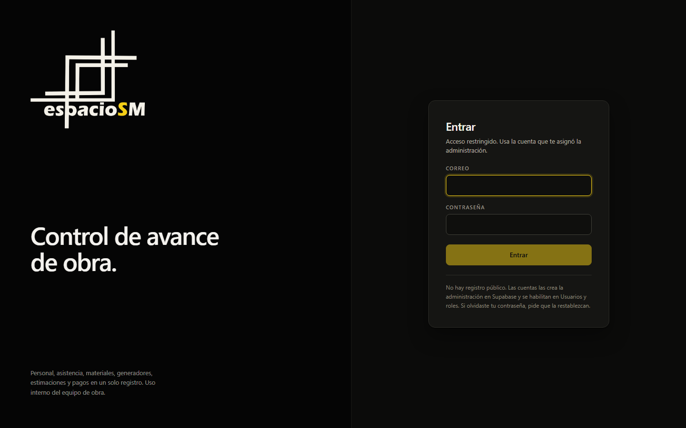
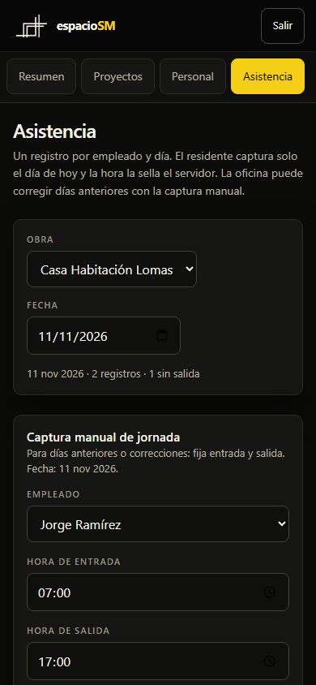

# espacioSM Obra

PWA de control de avance de obra para espacioSM. Concentra personal, asistencia,
materiales, generadores, estimaciones, solicitudes, pagos y bitácora en una sola
base de datos, con acceso por rol y aislamiento por proyecto. La interfaz usa el
tema oscuro y el logotipo institucional de espacioSM.

**Estado: Sprint 1 terminado y endurecido.** Funcionan el acceso con correo y
contraseña, el cambio de contraseña, los roles, los proyectos, el equipo por
obra, el personal, la asistencia con sellado en servidor y la administración de
usuarios. Los demás módulos aparecen en la navegación con su sprint
correspondiente y una pantalla de alcance.

- Aplicación publicada: `https://app.espaciosm.art`
- Repositorio: público, solo con código (sin llaves ni datos)
- Base de datos y autenticación: Supabase, plan gratuito

## Vistas

| Acceso | Asistencia en el teléfono |
| --- | --- |
|  |  |

Las capturas usan datos de ejemplo. La vista de acceso no contiene información
personal.

## Stack

| Capa | Tecnología |
| --- | --- |
| Interfaz | React 19 + TypeScript + Vite 8 |
| Ruteo | React Router 7, con rutas en el hash (`/#/asistencia`) |
| PWA | vite-plugin-pwa (service worker generado) |
| Datos y sesión | Supabase: Postgres, Auth, RLS |
| Estilos | CSS propio, sin dependencias de interfaz |
| Despliegue | GitHub Pages con GitHub Actions |
| PDF (Sprint 5) | jsPDF o react-pdf, generado en el navegador |

## Estructura

```
espaciosm-obra/
├─ .github/
│  ├─ workflows/deploy.yml        Compilación y publicación en GitHub Pages
│  └─ dependabot.yml              Actualización de dependencias y actions
├─ docs/                          Instalación, decisiones, esquema y pruebas
├─ public/                        Iconos, favicon, CNAME del dominio
├─ src/
│  ├─ componentes/                Barra, navegación, avisos, estados
│  ├─ datos/consultas.ts          Todas las consultas a Supabase
│  ├─ estilos/global.css          Sistema visual completo
│  ├─ lib/                        Cliente Supabase, tipos, formato, errores
│  ├─ paginas/                    Login, Resumen, Proyectos, Personal, Asistencia, Usuarios, Cuenta
│  ├─ sesion/SesionProvider.tsx   Sesión, perfil y permisos
│  ├─ App.tsx                     Rutas
│  ├─ navegacion.ts               Menú y fichas de módulos pendientes
│  └─ main.tsx                    Arranque
├─ pruebas/rls.mjs                Migraciones + RLS en Postgres embebido
├─ supabase/migrations/
│  ├─ 0001_esquema_sprint1.sql    Tablas, tipos, funciones, matriz de permisos
│  ├─ 0002_rls_sprint1.sql        Políticas RLS y privilegios
│  ├─ 0003_ajustes_post_instalacion.sql  Primer admin y verificación
│  ├─ 0004_endurecimiento_sprint1.sql    Acceso activo, perfiles, asistencia y grants
│  └─ 0005_revision_sprint1.sql          Auditoría solo admin y autor forzado
├─ .env.example                   Variables requeridas
├─ .npmrc                         Enlaces planos de pnpm (Windows)
└─ vite.config.ts                 Base, PWA, CSP de producción y manifiesto
```

## Puesta en marcha local

Requiere Node 20.19 o superior y pnpm 11.

```bash
pnpm install
cp .env.example .env      # en Windows: copy .env.example .env
# edita .env con la URL y la llave anon de Supabase
pnpm dev                  # http://localhost:5173
```

Para revisar la versión de producción:

```bash
pnpm build
pnpm preview
```

Para validar las migraciones y las políticas sin Supabase:

```bash
pnpm probar:sql
```

La prueba levanta un Postgres embebido, aplica `0001` a `0005`, y
verifica aislamiento por obra, sueldos ocultos, sellado de asistencia, historial,
permisos de ejecución, captura de la oficina y borrados bloqueados.

## Documentación

1. [Instalación paso a paso](docs/INSTALACION.md): Supabase, GitHub, dominio y
   pruebas con los residentes.
2. [Decisiones técnicas](docs/DECISIONES.md): por qué está armado así y qué
   falta decidir.
3. [Esquema y seguridad](docs/ESQUEMA.md): tablas, relaciones, RLS y consultas
   administrativas frecuentes.
4. [Pruebas de RLS](docs/PRUEBAS_RLS.md): casos que deben fallar antes de dar
   acceso a los residentes.

## Seguridad

- La llave `anon` de Supabase es pública por diseño; la protección real son las
  políticas RLS.
- La llave `service_role` nunca debe aparecer en el repositorio, en GitHub
  Actions ni en el navegador: salta todas las políticas.
- Una cuenta deshabilitada pierde acceso a todo, incluidas sus obras.
- El rol y el estado del perfil solo los cambia otro administrador; el correo se
  sincroniza desde Auth.
- La asistencia del residente se sella con fecha y hora del servidor, no se
  puede reescribir y queda en `asistencia_historial`.
- La compilación de producción incluye una CSP que limita scripts y conexiones
  al propio sitio y a `*.supabase.co`.
- El cambio de contraseña está en **Mi cuenta**. La verificación en dos pasos
  (TOTP) queda pendiente de interfaz.

## Siguientes sprints

| Sprint | Módulo | Estado |
| --- | --- | --- |
| 1 | Acceso, roles, proyectos, personal, asistencia | Terminado |
| 2 | Materiales: entradas, salidas, inventario | Pendiente |
| 3 | Generadores y estimaciones | Pendiente |
| 4 | Solicitudes de recursos y pagos | Pendiente |
| 5 | Bitácora y reporte PDF de status | Pendiente |
